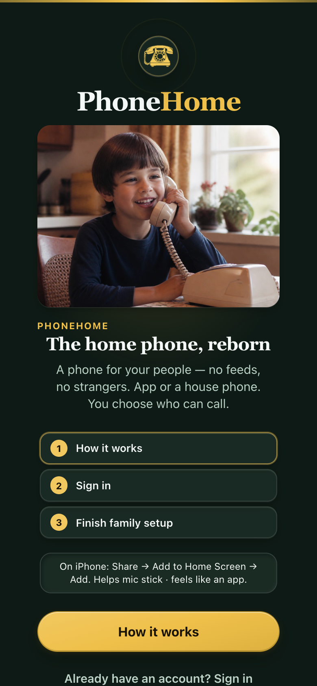
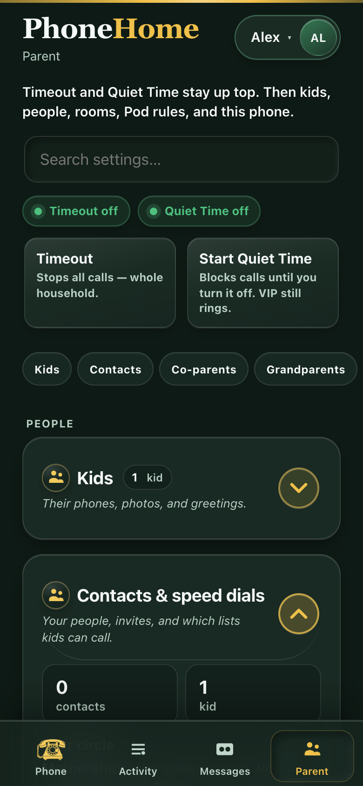
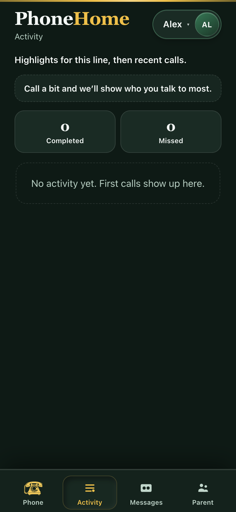
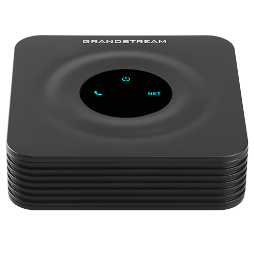

# PhoneHome

[](package.json)
[](https://github.com/trevlars/PhoneHome/actions/workflows/mothership-release.yml)
[](https://github.com/trevlars/PhoneHome/releases)

**The home phone, reborn.** A private, parent-controlled voice network for kids and extended family — self-hostable, encryption-first.

One **Mothership** (always-on server) hosts many **Pods** (families). Each parent curates **Circles** (who their kids can call). Cousins join with your HTTPS link + invite code — **no VPN, no carrier plan, no random internet dialing**.

<p align="center">
  
  &nbsp;&nbsp;
  
</p>

| | |
| --- | --- |
| **Repo** | [github.com/trevlars/PhoneHome](https://github.com/trevlars/PhoneHome) |
| **License** | Proprietary. Source is published for security review; not open source. See [LICENSE](LICENSE). |
| **Status** | Stage 1 shipped — softphones + analog HT801 lab path; [iOS TestFlight](https://testflight.apple.com/join/4SWCTNec) · App Store go-live: [`docs/app-store-go-live.md`](docs/app-store-go-live.md) (**free**) |
| **Releases** | [Mothership download bundles](https://github.com/trevlars/PhoneHome/releases) (macOS / Linux / Windows) · [iOS / iPad / Apple silicon Mac (TestFlight)](https://testflight.apple.com/join/4SWCTNec) |

> **Naming:** Product and GitHub repo are **PhoneHome**. Lab deploy paths (`/opt/kids-landline`, `kids-landline.service`, CT hostname) are legacy host names and stay as-is so production boxes don't break.

---

## Why PhoneHome?

Kids need a way to call grandma, cousins, and school friends' parents — without handing them a smartphone, a public number, or an unmoderated chat app.

<p align="center">
  
</p>

PhoneHome gives parents:

- **Allowlist-only calling** — mutual approval before anyone rings
- **Parent rules** — Quiet Time, daily caps, household Timeout (kill switch), Parent PIN
- **Kid-friendly phones** — big speed-dial pads, TreeHouse hangout rooms, Grandparent phone
- **Real house phones** — Grandstream HT801 analog adapter (SIP TLS + SRTP)
- **Your server** — one Mothership per extended-family network; you host, you control

---

## How it fits together

```
                    ┌─────────────────────────────────────┐
                    │           Mothership                │
                    │   (your always-on PhoneHome server) │
                    │   signaling · invites · rules · DB  │
                    └──────────────┬──────────────────────┘
                                   │
           ┌───────────────────────┼───────────────────────┐
           │                       │                       │
     ┌─────▼─────┐           ┌─────▼─────┐           ┌─────▼─────┐
     │  Pod A    │           │  Pod B    │           │  Pod C    │
     │ (Smiths)  │           │ (Joneses) │           │ (Grandma) │
     └─────┬─────┘           └─────┬─────┘           └─────┬─────┘
           │                       │                       │
     Mom's Circle            Dad's Circle            GP Circle
     Kid speed dials         Kid speed dials         Dial 1 = grandkid
           │                       │                       │
     ┌─────▼───────────────────────▼───────────────────────▼─────┐
     │  Leaves — softphones (PWA / iOS) · HT801 wall phones     │
     └──────────────────────────────────────────────────────────┘
```

**Terms:** full definitions in [`docs/glossary.md`](docs/glossary.md). **Family structures** (Pod vs Circle vs co-parent, with worked examples): [`docs/family-structures.md`](docs/family-structures.md).

| Term | Plain English |
| --- | --- |
| **Mothership** | The server — one per extended-family network |
| **Pod** | One household (Mom/Dad + kids) on that Mothership |
| **Circle** | A parent's approved contacts for their kids |
| **Leaves** | Phones on the network (app or analog) — not the server |
| **TreeHouse** | Kid hangout voice room (pad **0** / **1**) |
| **FamilyRoom** | Mixed family talk room (pad **#**) |

Most parents **join** someone else's Mothership as a new Pod. You only run a Mothership if you're the "family IT person."

---

## What's in Stage 1 (shipped)

<p align="center">
  
  &nbsp;
  
  &nbsp;
  
</p>

### For kids & parents

- Mobile-first **PWA softphone** — speed dial, themes, Add to Home Screen
- **Invite flow** — 6-digit code, 48h, single-use; cousins need URL + code only
- **Mutual allowlist** — both sides approve before calls connect
- **Parent controls** — Quiet Time (Bedtime / School / custom + US holiday skip), daily talk cap, Timeout, Parent PIN, Activity log
- **Voicemail / leave-a-message** — audio inbox after missed calls
- **TreeHouse & FamilyRoom** — household voice rooms with parent listen-only (audited, never silent)
- **Grandparent mode** — large buttons, plain language, parent-provisioned accounts
- **Co-parent invites** — share household management

### For hosts

- **Self-host Mothership** — **HAOS add-on**, Docker / Unraid, Mac / Linux / Windows service, or **Proxmox VE** LXC
- **30-day free trial** → **$25/year** host license ([`/trial`](web/src/trial.html) · [`/buy`](web/src/buy.html) · [`docs/host-license.md`](docs/host-license.md))
- **Vs Tin Can (stack cost, late 2026):** Tin Can handset ~$135 + Party Line ~$9.99/mo (~$100–$120/yr); PhoneHome softphone free, or ~$40 HT801 + ~$10–$40 analog + **$25/yr** software (year-1 analog ≈ $75–$105)
- **[Download bundles](https://github.com/trevlars/PhoneHome/releases)** — trial packages; paid updates while licensed ([`/downloads`](web/src/downloads.html))
- **HTTPS + TURN** guides — Cloudflare Tunnel, Caddy, coturn
- **HT801 analog path** — FreePBX sync, one-tap provision, SIP TLS + SRTP forced
- **Invite card PDF** — [`deploy/invite-card.html`](deploy/invite-card.html) for printing QR + code for relatives

<p align="center">
  
</p>

### In progress

- **iOS native app** (free — [TestFlight](https://testflight.apple.com/join/4SWCTNec); App Store checklist [`docs/app-store-go-live.md`](docs/app-store-go-live.md)) — Capacitor + CallKit/PushKit. Connect accepts Mothership HTTPS or full share links. See [`docs/native-ios-callkit.md`](docs/native-ios-callkit.md).
- **Host license** — 30-day trial, then **$25/year** for self-hosted Mothership (HAOS/Docker). Free iOS app. See [`docs/host-license.md`](docs/host-license.md).
- **Mothership peering** — friend-intro households that later host their own box. See [`docs/family-mesh.md`](docs/family-mesh.md) and [`docs/migrate-mothership.md`](docs/migrate-mothership.md).

### Planned (not Stage 1)

| Stage | Focus |
| --- | --- |
| **Stage 2** | Home Hub hardware, Bluetooth landline SKU, phone-as-soft-hub |
| **Stage 3** | Optional PSTN / 911; mothership peering for split households is in 1.x |

Details: [`docs/family-structures.md`](docs/family-structures.md), [`docs/family-mesh.md`](docs/family-mesh.md), [`docs/hub-hardware-brief.md`](docs/hub-hardware-brief.md).

---

## Privacy & encryption (product pillar)

Kids' and families' conversations are the product. **Encryption and security are not optional extras** — they are a release pillar.

| Surface | Baseline |
| --- | --- |
| Softphones | HTTPS + WebRTC **DTLS-SRTP** (server brokers ring/setup; no call-audio archive by default) |
| Analog ATA (HT801) | **SIP TLS + SRTP** — cleartext public SIP/RTP is not a supported path |
| Who can call | Allowlists, invites, quiet hours, kill switch |
| Call recording | Off by default; not in Stage 1 |

Doctrine, threats, and contributor rules:

- [`docs/privacy-security.md`](docs/privacy-security.md)
- [`docs/threat-model.md`](docs/threat-model.md)
- [`SECURITY.md`](SECURITY.md)

---

## Get started

### Parents — download a Mothership (easiest)

**No Git or Node.js required.**

1. Download your OS build from **[GitHub Releases](https://github.com/trevlars/PhoneHome/releases)**.
2. Install it — Mac: open the DMG, drag **PhoneHome Mothership** to Applications, launch (UFO icon in the menu bar). Linux: `./install-mothership.sh`. Windows: `install-mothership.ps1`.
3. Set a **public HTTPS URL** during setup (Cloudflare quick tunnel is the fastest path).
4. Open that URL on your phone → enter the **Mothership setup code** → create your Pod → invite family.

<p align="center">
  
</p>

Full guide: **[`docs/download-mothership.md`](docs/download-mothership.md)** · **[`docs/self-host.md`](docs/self-host.md)**

| OS | Download |
| --- | --- |
| Mac (Apple Silicon) | `PhoneHome-Mothership-*-macos.dmg` (menu bar app) · or `phonehome-mothership-v*-darwin-arm64.zip` |
| Mac (Intel) | Build from source (below) |
| Linux x64 | `phonehome-mothership-v*-linux-x64.tar.gz` |
| Linux ARM64 (Pi) | `phonehome-mothership-v*-linux-arm64.tar.gz` |
| Windows | `phonehome-mothership-v*-win-x64.zip` |

**Share with cousins:** your HTTPS URL + invite code. Print a card from [`deploy/invite-card.html`](deploy/invite-card.html).

### Developers — run from source (lab)

**Requirements:** Node.js **20+**, npm

```bash
git clone https://github.com/trevlars/PhoneHome.git
cd PhoneHome
npm install
npm run build
npm run start
```

Open **http://localhost:8787**. On first boot the Mothership prints a **setup code** (also written to `data/HOST_CODE.txt`).

**Smoke test (two browsers):**

1. Parent A: sign in with setup code → create household → add softphone → **Invite family**
2. Parent B: register (private window) → redeem invite → add softphone
3. Both: allowlist each other's lines → **Call**

For cousins off-LAN, you need HTTPS. Quick tunnel:

```bash
cloudflared tunnel --url http://127.0.0.1:8787
# set PUBLIC_BASE_URL to the printed https://….trycloudflare.com URL
```

Lab runbook: [`lab/README.md`](lab/README.md) · smoke checklist: [`lab/SMOKE.md`](lab/SMOKE.md)

### Install as a background service (from git)

```bash
./deploy/phonehome-init.sh    # writes ~/.phonehome/phonehome.env
./deploy/install-service.sh   # LaunchAgent / systemd / Windows task
```

**Analog (HT801):** after init, run [`deploy/setup-analog.sh`](deploy/setup-analog.sh) and [`deploy/install-freepbx-sync.sh`](deploy/install-freepbx-sync.sh) — see [`docs/self-host.md`](docs/self-host.md) and [`docs/ht801-lab.md`](docs/ht801-lab.md).

---

## iOS app

**Try the beta:** [TestFlight — iPhone, iPad, and Apple silicon Mac](https://testflight.apple.com/join/4SWCTNec)

<p align="center">
  
</p>

Capacitor shell around the PWA for notifications and optional CallKit lock-screen answer. Point the app at your Mothership HTTPS URL and sign in like the browser PWA.

```bash
# build from source (contributors)
# from repo root
npm run build -w web
cd mobile && npm install && npx cap sync ios && npx cap open ios
```

Bundle id: `app.phonehome.ios` · Docs: [`docs/native-ios-callkit.md`](docs/native-ios-callkit.md) · [`mobile/README.md`](mobile/README.md)

Default: **in-app calling** (tap notification → Answer in PhoneHome). Lock-screen CallKit is opt-in under Parent → This phone.

---

## Documentation

| Doc | Topic |
| --- | --- |
| [`docs/glossary.md`](docs/glossary.md) | Mothership, Pod, Circle, Leaves |
| [`docs/family-structures.md`](docs/family-structures.md) | Pod vs Circle vs co-parent — structures parents use (worked examples) |
| [`docs/self-host.md`](docs/self-host.md) | Full Mothership install (HTTPS, TURN, FreePBX, Docker) |
| [`docs/download-mothership.md`](docs/download-mothership.md) | Release bundles for parents |
| [`docs/parent-ux.md`](docs/parent-ux.md) | Onboarding, Parent panel, grandparent mode |
| [`docs/portal-spec.md`](docs/portal-spec.md) | Stage 1 feature parity + API surface |
| [`docs/family-mesh.md`](docs/family-mesh.md) | Invites, TreeHouse, federation roadmap |
| [`docs/privacy-security.md`](docs/privacy-security.md) | Encryption pillar |
| [`docs/threat-model.md`](docs/threat-model.md) | Threats and non-goals |
| [`docs/native-ios-callkit.md`](docs/native-ios-callkit.md) | iOS CallKit + PushKit |
| [`docs/watchos-kid-speed-dial.md`](docs/watchos-kid-speed-dial.md) | Apple Watch kid speed dial (not started) |
| [`docs/ht801-lab.md`](docs/ht801-lab.md) | Grandstream HT801 analog lab |
| [`docs/hosting.md`](docs/hosting.md) | Proxmox / VPS notes |
| [`docs/mothership-unraid-proxmox.md`](docs/mothership-unraid-proxmox.md) | Unraid Docker + Proxmox VE installer |
| [`docs/managed-mothership.md`](docs/managed-mothership.md) | Paid isolated cloud Mothership architecture + operations |
| [`docs/managed-pilot.md`](docs/managed-pilot.md) | Invite-only paid pilot acceptance gate |
| [`docs/listen-in-future.md`](docs/listen-in-future.md) | Future listen-in constraints |
| [`docs/hub-hardware-brief.md`](docs/hub-hardware-brief.md) | Stage 2 hardware SKUs |
| [`docs/screenshots/README.md`](docs/screenshots/README.md) | Regenerate README screenshots |
| [`SECURITY.md`](SECURITY.md) | Vulnerability reporting |

---

## Repo layout

| Path | Role |
| --- | --- |
| [`server/`](server/) | Mothership — signaling, REST API, WebSocket, SQLite, APNs, FreePBX sync |
| [`web/`](web/) | Parent PWA / softphone UI |
| [`mobile/`](mobile/) | Capacitor iOS app + CallKit plugin |
| [`mobile/app-store/`](mobile/app-store/) | App Store / TestFlight screenshots + listing copy |
| [`deploy/`](deploy/) | Init scripts, service installers, Docker Compose, Mothership bundles, invite card |
| [`docs/`](docs/) | Specs, glossary, self-host, privacy, threat model |
| [`docs/screenshots/`](docs/screenshots/) | README marketing + UI captures |
| [`bridged/`](bridged/) | SIP↔WebRTC bridge notes (live with FreePBX) |
| [`hardware/`](hardware/) | Stage 2 HW stubs (hub, satellite, bt-landline) |
| [`hub-os/`](hub-os/) | Future appliance image notes |
| [`lab/`](lab/) | Lab runbook and smoke tests |

---

## Development

```bash
npm run dev          # server with watch
npm run dev:web      # web assets watch
npm run build        # web + server
npm test             # server tests
npm run lab          # build web + start server
npm run screenshots  # refresh docs/screenshots + mobile/app-store/screenshots
npm run app-store:screenshots  # App Store / TestFlight frames only
```

| Script | Purpose |
| --- | --- |
| `npm run phonehome:init` | Write `~/.phonehome/phonehome.env` |
| `npm run phonehome:install` | Install background service |
| `npm run phonehome:analog` | Analog / FreePBX setup helper |
| `npm run serve` | Supervisor (hub + bridge) |

**Mothership scale defaults** (override in `phonehome.env`): hard cap 50 lines (softphones + ATAs), warning at 40; no Pod cap unless you set one. See [`docs/glossary.md`](docs/glossary.md#how-big).

---

## Community

| Channel | Link |
| --- | --- |
| **Website** | [phonehome.pages.dev](https://phonehome.pages.dev) |
| **TestFlight** | [Join beta](https://testflight.apple.com/join/4SWCTNec) |
| **Reddit** | [r/PhoneHome](https://reddit.com/r/PhoneHome) |
| **GitHub Discussions** | [Q&A & ideas](https://github.com/trevlars/PhoneHome/discussions) |
| **Discord** | [discord.gg/QWmCcnJn2Q](https://discord.gg/QWmCcnJn2Q) |
| **Press** | [Press kit](https://phonehome.pages.dev/press.html) · [`docs/marketing/press-kit.md`](docs/marketing/press-kit.md) |

Marketing playbook, content calendar, and account setup: [`docs/marketing/`](docs/marketing/).

---

## Contributing & security

PhoneHome is early but real — family-tested softphone flows, analog lab path, and self-host tooling.

- **Security issues:** do not open public GitHub issues with exploit detail. See [`SECURITY.md`](SECURITY.md).
- **Privacy regressions:** read [`docs/privacy-security.md`](docs/privacy-security.md) before PRs that touch transports, logging, or ATA config.
- **Cursor / agent rules:** [`.cursor/rules/privacy-security-pillar.mdc`](.cursor/rules/privacy-security-pillar.mdc) encodes non-negotiables for automated contributors.

---

## License

Proprietary. Copyright © 2026 Trevor Larsen Marketing LLC. All rights reserved. See [`LICENSE`](LICENSE).

The source is public so you can inspect what the Mothership does. That is not permission to copy, modify, or redistribute it. A Mothership host license is permission to run one instance.

## Trademarks

Tin Can, Pinwheel, Ooma, Gabb, TickTalk, Gizmo, Apple, iPhone, Home Assistant, Grandstream, HT801, and other product names in this repo are trademarks of their respective owners, used only to identify and compare products. PhoneHome is not affiliated with, endorsed by, or sponsored by any of them. Comparison figures reflect public pricing and policies at the dates noted and may change.

Maintained by [trevlars](https://github.com/trevlars).
