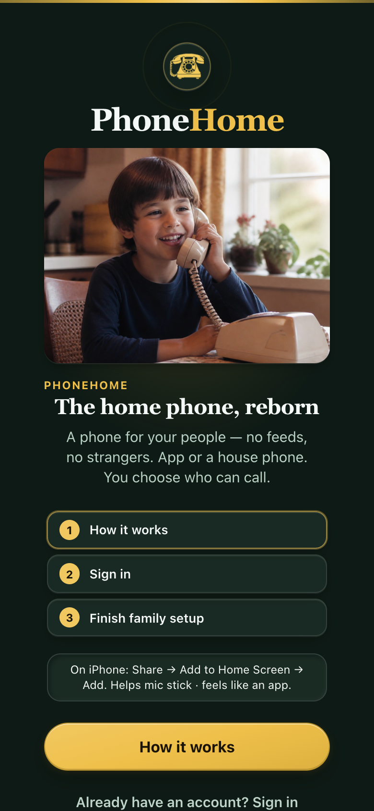

# Native iOS softphone (in-app UI + optional CallKit)

PhoneHome’s Stage‑1 softphone is a PWA. Cap iOS wraps it for notifications and (optionally) system CallKit.

## TestFlight

**[Join the beta](https://testflight.apple.com/join/4SWCTNec)** — iPhone, iPad, and Apple silicon Mac (M-series). Install from TestFlight, open **PhoneHome**, and sign in to your Mothership **HTTPS** URL (same as the browser PWA).

**Naming:** The product is **PhoneHome**. The installed app, Home Screen label, and CallKit UI use **PhoneHome** (`CFBundleDisplayName`). The App Store title is **PhoneHome: Family Calling** because the exact global title `PhoneHome` is unavailable.

**Tester notes:** `mobile/app-store/metadata/en-US/testflight_what_to_test.txt` — push to App Store Connect with `cd mobile && ./scripts/asc-upload.sh upload_testflight`.

<p align="center">
  
</p>

**App Store / TestFlight listing screenshots:** [`mobile/app-store/README.md`](../mobile/app-store/README.md) — run `npm run app-store:screenshots` to regenerate iPhone, iPad, and Mac marketing frames.

| Layer | Role |
| --- | --- |
| `mobile/` | Capacitor iOS app (`app.phonehome.ios`) |
| `mobile/plugins/phonehome-callkit` | CallKit + PushKit + **alert APNs** Capacitor plugin |
| `web/` | Softphone UI (loaded live from HTTPS or bundled) |
| `server/` | Device token store + APNs (alert and/or VoIP) + pending SDP |

## Current default: CallKit **required** (always on)

Lock-screen Answer via CallKit + PushKit VoIP is **on for every Cap iOS install**. There is no parent toggle.

| Flag | Where | Default |
| --- | --- | --- |
| `PhoneHomeCallKitEnabled` | iOS `Info.plist` | `true` |
| `kl_callkit` | JS `localStorage` + native UserDefaults | forced `1` on boot |
| `IOS_CALLKIT` / `CALLKIT_ENABLED` | Hub server env | unset → **auto** |

**Apple constraint:** PushKit VoIP pushes **require** reporting to CallKit. The native plugin always arms PushKit and ignores disable requests from older clients.

Hub kill switch only: `IOS_CALLKIT=0` forces alert APNs even if a VoIP token exists (ops emergency — not a parent setting).

## What works (CallKit + PushKit — required path)

1. Plugin always registers **PushKit VoIP** and reports tokens to `POST /api/devices/voip-token`.
2. Server sends VoIP pushes (`apns-topic` `….voip`) when a VoIP token exists.
3. Plugin reports **CallKit** incoming; Answer drives JS accept.

### Hub fallback (alert APNs)

Used only when a line has **no** VoIP token yet (fresh install before first open, or `IOS_CALLKIT=0`):

1. Plugin also registers **standard APNs** (`registerAlertPush`) for voicemail / non-CallKit wakes.
2. Server may send an **alert push** (“PhoneHome — Call from X”).
3. Tap opens the app → WS / `/api/calls/pending` → softphone ring/answer UI.

## Apple Developer hoops (you do these once)

1. App ID `app.phonehome.ios` with **Push Notifications**.
2. Create an **APNs Auth Key** (.p8) — Keys → Apple Push Notifications service.
3. Enable Background Modes (already in `Info.plist`).
4. VoIP topic (CallKit path only): `app.phonehome.ios.voip`. Alert topic: `app.phonehome.ios`.
5. In Xcode: signing team, capability **Push Notifications**.

### Server env (CT 122 / lab)

```bash
APNS_KEY_ID=XXXXXXXXXX
APNS_TEAM_ID=XXXXXXXXXX
APNS_BUNDLE_ID=app.phonehome.ios
APNS_KEY_P8=/var/lib/kids-landline/AuthKey_XXX.p8
# APNS_PRODUCTION=1   # prefer production first; omit to prefer sandbox/dev
# IOS_CALLKIT=0       # hub kill switch: never send VoIP (alert only)
```

The hub retries the other APNs host on `BadDeviceToken` so a TestFlight/production phone and an Xcode/sandbox phone can share the same hub. The working host is stored on the token.

Without APNs keys, pushes are skipped (logged) so lab softphone WS still works when the app is open.

### Managed Mothership push gateway

Managed customer VPSs never receive the PhoneHome Apple `.p8` key. Set:

```bash
PUSH_GATEWAY_URL=https://push.phonehome.example
MOTHERSHIP_INSTANCE_ID=inst_…
MOTHERSHIP_INSTANCE_SECRET=…
```

The Mothership keeps device tokens in its own database and sends a short-lived
instance-authenticated request containing the token and minimal wake metadata
to the stateless gateway. The gateway holds the Apple credential. It receives
no SDP, media, SIP credentials, or call content. Self-hosted installations may
omit these values and continue using local `APNS_*` configuration.

## Build & run

**Preferred (no Xcode debugger — avoids iOS‑beta symbol / pause pain):**

```bash
cd mobile && ./scripts/run-on-device.sh
```

`run-on-device.sh` sources `scripts/asc.env` (or another app’s) and passes App Store Connect API key flags to `xcodebuild` so automatic signing works from the terminal — the same machine can build fine in the Xcode app while CLI would otherwise print **“No Accounts”** without those flags.

Or manually:

```bash
npm run build -w web
cd mobile
npm install
npx cap sync ios
npx cap open ios
```

Default: ship the **bundled** softphone. Parents enter their **Mothership HTTPS URL** once (or paste a full invite / Grandma share link). Saved in UserDefaults `ph_mothership_url`. Change anytime under **Parent → This phone → Change Mothership address** — no reinstall when DDNS moves.

Connect accepts `/?join=`, `/?gp=`, and `/?invite=` share links: the origin is saved and the WebView opens with the token so invites survive the Cap → hub hop.

Optional lab seed: `PHONEHOME_CAP_URL=https://…` before `npx cap sync ios` / `run-on-device.sh` copies into UserDefaults on first launch only.

```bash
# Normal / TestFlight — user picks URL in-app
npx cap sync ios

# Lab seed (optional)
PHONEHOME_CAP_URL=https://mothership.example:8443 npx cap sync ios
```

**iOS 26/27 note:** the app uses a `SceneDelegate` (required). Running under the Xcode debugger with incomplete device symbols can still “pause”; prefer `run-on-device.sh` or **Run Without Debugging**.

## Mothership URL (native)

| API | Role |
| --- | --- |
| `getMothershipUrl` | Read saved HTTPS origin |
| `setMothershipUrl` | Save + reload WebView onto hub |
| `clearMothershipUrl` | Clear + return to bundled softphone |

First launch / unreachable hub: **same splash → How it works as the website**, then **Connect** (HTTPS or share link). Walkthrough completion is stored in native UserDefaults so the Mothership hop does not replay it. Change hub anytime under Parent → This phone → Change Mothership address.
## App icon badge (missed + voicemail)

The softphone sets the **iOS home-screen badge** from real product counts (no FreePBX MWI yet):

| Count | Source | Clears when |
| --- | --- | --- |
| Unread voicemail | `voicemails.listened = 0` for the active line | Message is played (existing listen API) |
| Unseen missed | Inbound `call_logs` with `outcome = missed` newer than a per-line localStorage cursor | User opens **Activity** |

Native API (plugin): `requestBadgePermission`, `setBadge({ count })`, `clearBadge`.

JS syncs on `/api/me` refresh, `voicemail.new`, CallKit decline/timeout (if CallKit on), app foreground, and line switch.

### How to test Lock-screen Answer

1. Rebuild native (or open Cap app against hub JS that forces CallKit on).
2. Open PhoneHome once so PushKit registers a VoIP token.
3. Kill the app → place inbound call → **system incoming UI** (not just a banner).
4. Answer from the lock screen → VoIP wake + ICE + **two-way audio** via native WebRTC.

### Known gaps / residual limits

- **Fresh install before first open:** no VoIP token yet → hub may send alert APNs until the app launches once.
- **Lock-screen Answer:** media runs in-process via **WebRTC.framework** + `RTCAudioSession.audioSessionDidActivate` in `provider(_:didActivate:)`. Cap JS keeps hub WebSocket signaling only.
- **No badge-only silent push yet** for voicemail when fully killed (same as before).
- FreePBX MWI / analog mailbox LED sync is a follow-up.

## Sign-in (session + Face ID)

WKWebView `localStorage` is not a reliable password vault. After a successful username/password sign-in the iOS shell stores:

- **Session token** in Keychain (`AfterFirstUnlockThisDeviceOnly`) so a WebView storage wipe doesn’t dump you at login.
- **Username + password** in Keychain. **Face ID / Touch ID** (or device passcode) is required to read the password.

**Confirmed working** on the lab iPhone (15 Pro Max) with the Keychain plugin on-device. Rebuild the native app after plugin changes (`mobile/scripts/run-on-device.sh` or Xcode). The live HTTPS UI can ship first; Face ID only works once that native plugin is on the phone.

A session-only restore does **not** write a password. If Face ID never prompted after a rebuild, open **Parent → Account → Save for Face ID** and type your password once. Sign-in with username/password (or set/change password) also writes Keychain.

Sign-out keeps the saved password for Face ID next time. **Forget saved sign-in** on the login screen, **Forget Face ID** under Account, or deleting the account, clears Keychain login.

## Privacy

Pushes carry **callId + display name + line ids only** — no SDP/media. Audio stays WebRTC DTLS-SRTP after answer. See `docs/privacy-security.md`.
