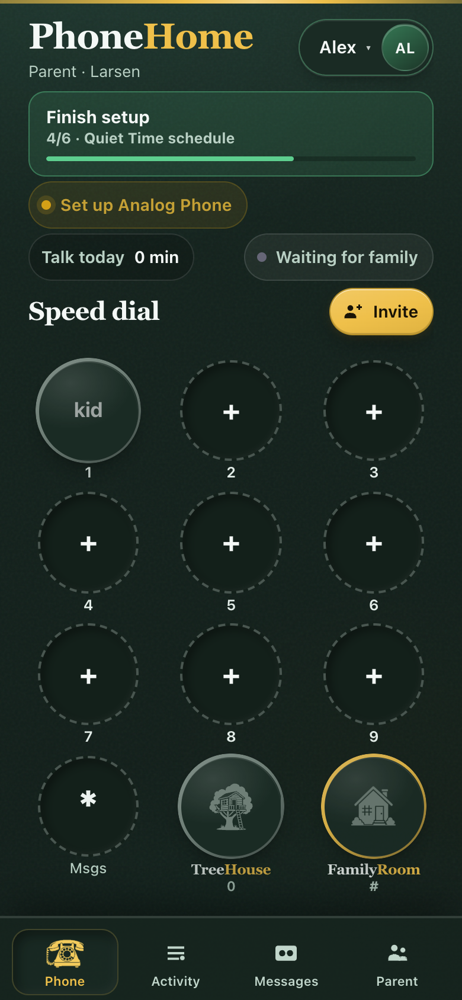

# PhoneHome iOS (Capacitor)

Native shell around the existing softphone for **CallKit + PushKit**.

## TestFlight (iPhone, iPad, Apple silicon Mac)

**[Join the beta](https://testflight.apple.com/join/4SWCTNec)** — install from TestFlight, open the app, and sign in to your Mothership HTTPS URL.

<p align="center">
  
</p>

**App Store listing assets:** [`app-store/README.md`](app-store/README.md) — screenshots (`npm run app-store:screenshots`) and metadata for App Store Connect.

See **[`docs/native-ios-callkit.md`](../docs/native-ios-callkit.md)** for Apple setup and server env.

## Build from source

```bash
# from repo root
npm run build -w web
cd mobile && npm install && npx cap sync ios && npx cap open ios
```

Bundle id: `app.phonehome.ios`
