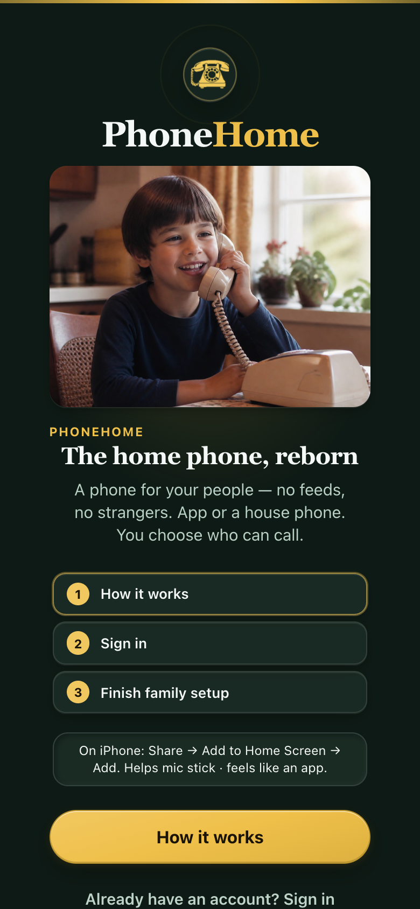

# PhoneHome iOS (Capacitor)

Native shell around the existing softphone for **CallKit + PushKit**. **Free** on the App Store (Safari softphone still works).

## App Store

**[PhoneHome: The Landline Reborn](https://apps.apple.com/app/id6804245868)** — install from the App Store, open **PhoneHome**, and paste your Mothership HTTPS URL (or a full invite / Grandma share link).

## TestFlight (iPhone, iPad, Apple silicon Mac)

**[Join the beta](https://testflight.apple.com/join/4SWCTNec)** — extra builds before they hit the store.

Push tester notes after editing copy:

```bash
cd mobile
./scripts/asc-upload.sh upload_testflight   # What to Test + beta description
fastlane ios testflight_info                # verify groups, builds, notes
```

New builds: bump `CURRENT_PROJECT_VERSION` in `ios/App/App.xcodeproj`, then **Product → Archive** in Xcode and upload to TestFlight (or `fastlane ios release_testflight` once distribution signing is healthy).

<p align="center">
  
</p>

**App Store listing assets:** [`app-store/README.md`](app-store/README.md) · **Go-live checklist:** [`docs/app-store-go-live.md`](../docs/app-store-go-live.md)

See **[`docs/native-ios-callkit.md`](../docs/native-ios-callkit.md)** for Apple setup and server env.

## Android

Same softphone, Telecom incoming/outgoing UI, FCM wake, biometric sign-in. `applicationId` is `app.phonehome.android`. Media stays in the WebView (DTLS-SRTP). No Play listing yet. Details: **[`docs/native-android.md`](../docs/native-android.md)**.

```bash
export JAVA_HOME=/opt/homebrew/opt/openjdk@21
export ANDROID_HOME=/opt/homebrew/share/android-commandlinetools
cd mobile && npx cap sync android && cd android && ./gradlew assembleDebug
```

Drop `google-services.json` in `mobile/android/app/` before FCM will register. The hub needs `FCM_SERVICE_ACCOUNT_JSON`.

## Build from source

```bash
# from repo root
npm run build -w web
cd mobile && npm install && npx cap sync ios && npx cap open ios
```

Bundle id: `app.phonehome.ios`
